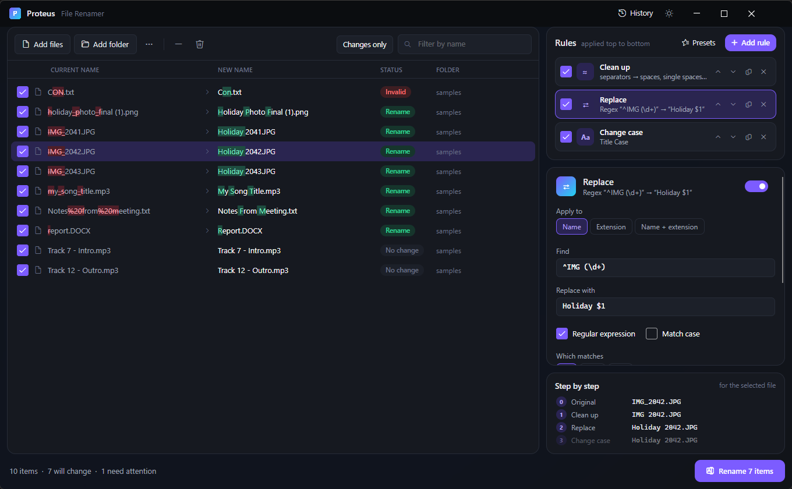
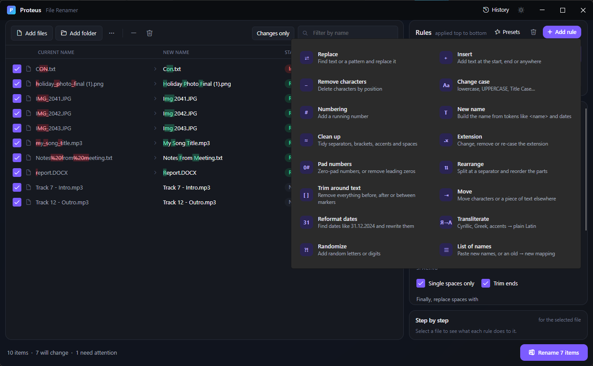
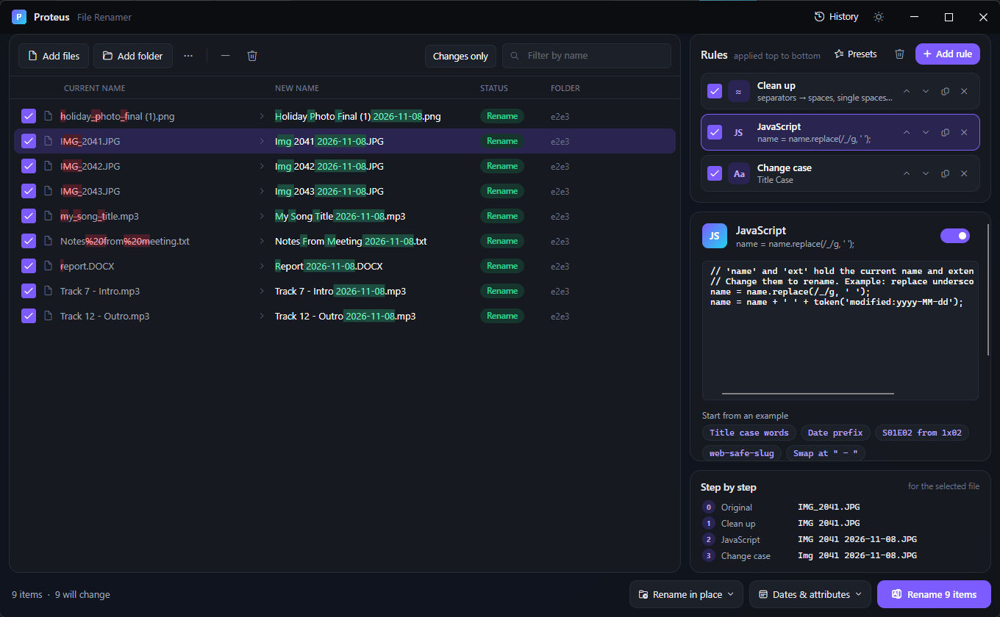
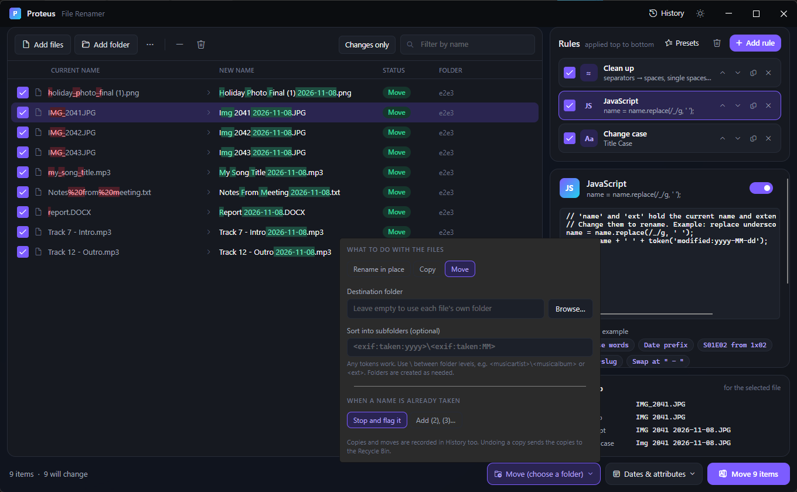
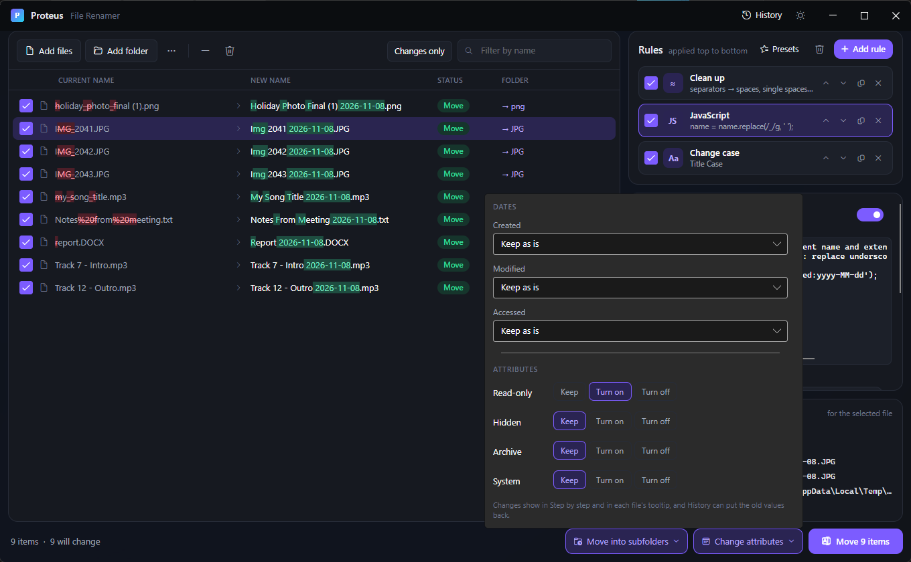
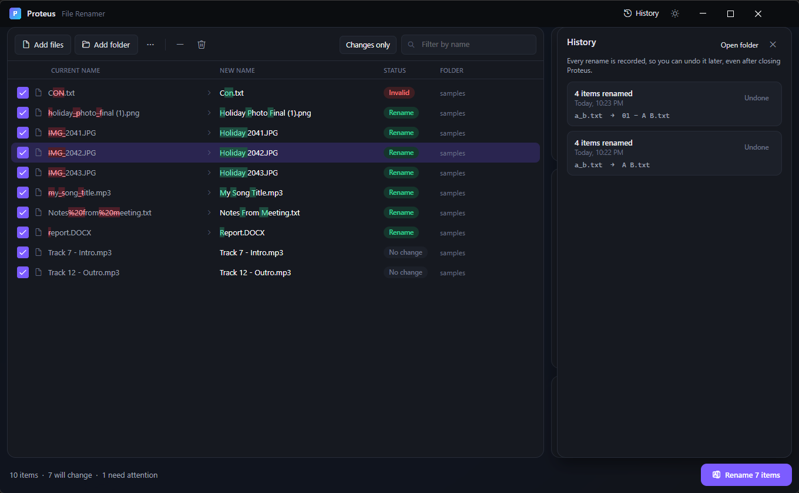
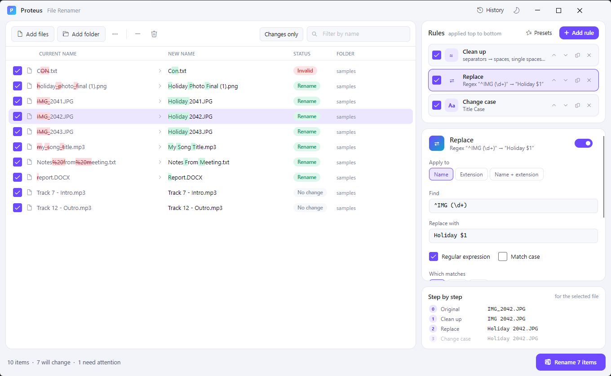

<div align="center">


# Proteus - File Renamer

**A modern, safe and seriously powerful bulk file renamer for Windows.**

Build a stack of rules, watch every new name update live with the changes highlighted, and rename
thousands of files in one go. Every batch can be undone, even days later.

[](#requirements)
[](https://dotnet.microsoft.com/)
[](https://avaloniaui.net/)
[](LICENSE)
[](docs/guide/12-settings-portable.md#portable-mode)

[**⬇ Download**](https://github.com/Urrrshurrr/Proteus/releases/latest) ·
[**Knowledge base**](docs/guide/README.md) ·
[Getting started](docs/guide/01-getting-started.md) ·
[Rule reference](docs/guide/04-rule-reference.md) ·
[Tokens](docs/guide/05-tokens.md) ·
[JavaScript](docs/guide/06-javascript.md) ·
[Recipes](docs/guide/13-recipes.md)

<br />



</div>

---

## ✨ Highlights

<table>
<tr>
<td width="50%" valign="top">

### 👀 See every change before it happens
The new-name column updates as you type, with **added characters in green** and **removed ones
struck through in red**. A **Step by step** panel shows what each rule did to the selected file.

</td>
<td width="50%" valign="top">

### 🧱 17 composable rules
Replace (text or regex), Insert, Remove, Case, Numbering, New name, Clean up, Extension, Pad
numbers, Rearrange, Trim around text, Move, Reformat dates, Transliterate, Randomize, List of
names, and **JavaScript**. Stack them in any order.

</td>
</tr>
<tr>
<td valign="top">

### 🏷️ ~75 metadata tokens
Photo EXIF, video length/resolution/quality, music tags (MP3, FLAC, M4A, WMA, OGG), Word/Excel/PowerPoint/PDF
properties (no Office needed), hashes, dates, counters, plus **any Windows property** by name.

</td>
<td valign="top">

### 🧩 Scripting when you need it
A sandboxed **JavaScript** rule with `name`, `ext`, `number`, `original.path`, `token('…')`,
`pad()` and modern JS. Errors show with line numbers; scripts can't touch your files.

</td>
</tr>
<tr>
<td valign="top">

### 📦 Copy, move and organise
Rename in place, or **copy/move** into a folder, **sorted into subfolders** built from tokens such as
`<exif:taken:yyyy>\<exif:taken:MM>` or `<music:artist>\<music:album>`.

</td>
<td valign="top">

### 🕰️ Dates and attributes
Set created/modified/accessed from EXIF, media, document metadata, a date in the name, or a fixed
date, with a time shift for wrong camera clocks. Toggle read-only, hidden, archive and system.

</td>
</tr>
<tr>
<td valign="top">

### 🛡️ Safe by design
Never overwrites. Swaps and cycles (`a↔b`) and case-only renames just work. Invalid Windows names
and clashes are flagged before you start. The plan is journaled **before** anything is touched.

</td>
<td valign="top">

### ↩️ Undo, even after a restart
Every batch is recorded in **History**. Undo moves files back, restores dates and attributes,
removes folders it created, and sends copies to the Recycle Bin, carefully.

</td>
</tr>
<tr>
<td valign="top">

### 📊 CSV in, CSV out
Rename straight from a spreadsheet (current file → new name), or export the whole preview for
review and sign-off.

</td>
<td valign="top">

### 🎒 Truly portable
One `Proteus.exe`, no installer, no .NET needed. Drop a `portable.txt` beside it and all settings
and history live next to the exe.

</td>
</tr>
</table>

## 🖼️ A closer look

<table>
<tr>
<td width="50%"><br /><sub><b>17 rules</b>, added with one click and stacked in any order</sub></td>
<td width="50%"><br /><sub><b>JavaScript rule</b> with ready-made examples</sub></td>
</tr>
<tr>
<td><br /><sub><b>Copy / move</b> into token-built subfolders</sub></td>
<td><br /><sub><b>Dates & attributes</b>, previewed and undoable</sub></td>
</tr>
<tr>
<td><br /><sub><b>History</b>: undo any batch, any time</sub></td>
<td><br /><sub><b>Light and dark</b> themes</sub></td>
</tr>
</table>

## 🚀 Quick start

1. **Get Proteus**: download `Proteus.exe` (or the portable zip) from the [latest release](https://github.com/Urrrshurrr/Proteus/releases/latest), put it anywhere and run it. No installer needed.
2. **Add files**: drag files or folders onto the window.
3. **Add rules**: click **+ Add rule** and watch the *New name* column.
4. **Check**: anything marked *Conflict* or *Invalid* is skipped; hover to see why.
5. **Rename**: press **Ctrl+Enter**. Changed your mind? **Ctrl+Z**.

👉 The **[knowledge base](docs/guide/README.md)** walks through everything step by step.

### A taste of what's possible

| Goal | How |
|---|---|
| `IMG_2041.JPG` → `2024-07-14_153012.jpg` | *New name* `<exif:taken:yyyy-MM-dd_HHmmss>` + *Extension* lowercase |
| Photos into `2024\07\` folders | Mode **Move**, subfolders `<exif:taken:yyyy>\<exif:taken:MM>` |
| `03 - Radiohead - Airbag.mp3` from tags | *New name* `<music:track:2> - <music:artist> - <music:title>` |
| `Show.Name.s01e02.WEB.mkv` → `Show Name - S01E02.mkv` | A three-line [JavaScript recipe](docs/guide/13-recipes.md#tv-episodes) |
| `Invoice 31.12.2024.pdf` → `Invoice 2024-12-31.pdf` | *Reformat dates* `dd.MM.yyyy` → `yyyy-MM-dd` |
| `clip.mp4` → `clip [1080p 03-42].mp4` | *Insert* ` [<video:quality> <video:duration>]` at end |
| Rename from an Excel list | `...` → **Import a rename list (CSV)** |

More in the [recipes](docs/guide/13-recipes.md).

## 📚 Documentation

| | |
|---|---|
| [Getting started](docs/guide/01-getting-started.md) | Install, the screen at a glance, your first rename |
| [Adding and managing files](docs/guide/02-files.md) | Folders, include/exclude, sorting, filtering |
| [Working with rules](docs/guide/03-rules.md) | The rule stack, *Apply to*, per-rule file filters |
| [Rule reference](docs/guide/04-rule-reference.md) | All 17 rules, every option, with examples |
| [Tokens and metadata](docs/guide/05-tokens.md) | The complete token list |
| [JavaScript scripting](docs/guide/06-javascript.md) | Script API, recipes, limits |
| [Copy and move](docs/guide/07-copy-move.md) | Destinations, subfolders, name clashes |
| [Dates and attributes](docs/guide/08-dates-attributes.md) | Timestamps and file attributes |
| [CSV import and export](docs/guide/09-csv.md) | Rename from spreadsheets, export previews |
| [Presets, history and undo](docs/guide/10-presets-history.md) | Reuse setups, undo past batches |
| [Safety and status messages](docs/guide/11-safety.md) | What every status means |
| [Settings and portable mode](docs/guide/12-settings-portable.md) | Themes, data locations, USB use |
| [Recipes](docs/guide/13-recipes.md) · [FAQ](docs/guide/14-faq.md) | Ready-made solutions and answers |

## 🛠️ Build from source

Requires the [.NET 8 SDK](https://dotnet.microsoft.com/download) on Windows.

```bash
git clone https://github.com/Urrrshurrr/Proteus.git
cd Proteus
dotnet run --project src/Proteus.App
```

**Portable single-file exe** (~45 MB, runs without .NET installed):

```bash
dotnet publish src/Proteus.App -c Release -r win-x64 --self-contained true -p:PublishSingleFile=true -p:IncludeNativeLibrariesForSelfExtract=true -p:EnableCompressionInSingleFile=true -p:DebugType=none -o publish
```

**Tests** (95 unit and view-model tests):

```bash
dotnet test
```

### Project layout

```
src/Proteus.Core     Rename engine: rules, tokens, metadata readers (EXIF, ID3, MKV, Office, PDF,
                     Windows properties), validator, safe executor, undo journal, presets, CSV
src/Proteus.App      Avalonia UI (MVVM with CommunityToolkit.Mvvm), custom controls and theme
tests/Proteus.Tests  xUnit tests, including every recipe in the knowledge base
docs/                Knowledge base and screenshots
```

### Built with

| Component | Purpose | License |
|---|---|---|
| [Avalonia UI](https://avaloniaui.net/) 12 + Fluent theme | Cross-platform UI framework | MIT |
| [CommunityToolkit.Mvvm](https://github.com/CommunityToolkit/dotnet) | MVVM source generators | MIT |
| [MetadataExtractor](https://github.com/drewnoakes/metadata-extractor-dotnet) | Photo EXIF | Apache-2.0 |
| [Jint](https://github.com/sebastienros/jint) | Sandboxed JavaScript engine | BSD-2-Clause |
| [xUnit](https://xunit.net/) | Tests | Apache-2.0 |

Everything else (diff highlighting, ID3, Matroska, Office/OpenDocument/PDF readers, Windows
property access, the safe rename executor) is built into the project.

## Requirements

- Windows 10 or 11, 64-bit
- Nothing else for the published exe; the .NET 8 SDK to build from source

## 📄 License

[MIT](LICENSE). Free for personal and commercial use.
