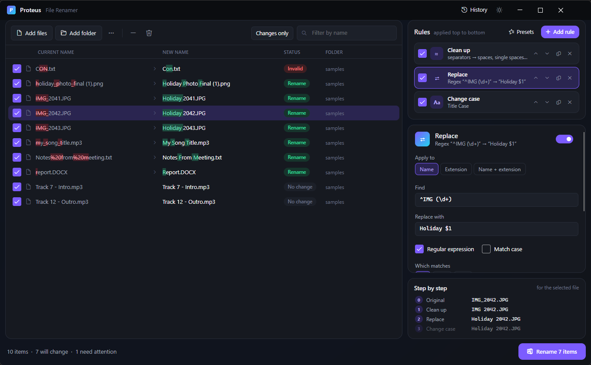

# 1. Getting started

[Knowledge base](README.md) › Getting started

## Install

Proteus is a single, portable `Proteus.exe` for 64-bit Windows 10 or 11. There is nothing to install.

1. Build it (see [Building from source](#building-from-source)) or copy a `Proteus.exe` you already have.
2. Put it anywhere you like, for example `C:\Tools\Proteus\`.
3. Double-click it.

> Want Proteus to leave nothing behind on the PC? See [portable mode](12-settings-portable.md#portable-mode).

You can also start Proteus with files already loaded: drag files onto `Proteus.exe`, or run
`Proteus.exe "D:\Photos\Trip"` from a command line or a shortcut.

## The screen at a glance



| Area | What it's for |
|---|---|
| **File list** (left) | The files and folders you are renaming. Each row shows the **current name**, the **new name** with changed characters highlighted, a **status**, and the **folder**. |
| **Toolbar** (above the list) | *Add files*, *Add folder*, the `...` options menu, remove selected, clear the list, *Changes only*, and a filter box. |
| **Rules** (top right) | Your stack of rules. They run from top to bottom. |
| **Rule editor** (middle right) | Settings for the selected rule. |
| **Step by step** (bottom right) | What each rule does to the selected file, one step at a time. |
| **Bottom bar** | Item counts and messages, the *mode* button (rename/copy/move), *Dates & attributes*, and the main **Rename** button. |
| **Title bar** | *History* (undo past batches) and the light/dark theme switch. |

## Your first rename in 60 seconds

1. **Add files.** Drag a few files or a folder onto the list, or click **Add files**.
2. **Look at the preview.** Proteus starts with two rules, *Clean up* and *Change case*, so you'll
   already see new names such as `my_holiday_photo.jpg` → `My Holiday Photo.jpg`.
   Green highlights show what's being added; red strike-through shows what's removed.
3. **Add a rule.** Click **+ Add rule** → **Numbering**. Each file now gets `01 - `, `02 - `, …
4. **Adjust it.** In the editor, set *Digits* to 3 and *Separator* to `_`. The preview updates as you type.
5. **Check the status column.** Anything marked *Conflict* or *Invalid* won't be touched. Hover a row to see why.
6. **Rename.** Click **Rename N items** (or press **Ctrl+Enter**).
7. **Changed your mind?** Click **Undo** in the message that appears, or press **Ctrl+Z**.

Nothing happens to your files until step 6, and every batch can be undone later from **History**.

## How Proteus thinks

- **Rules form a pipeline.** The first rule changes the original name, the second rule changes the
  result of the first, and so on. Order matters. Use the arrows on each rule to reorder.
- **The preview is the plan.** What you see in *New name* is exactly what will happen.
- **List order matters for counters.** Numbering follows the order of the list. Click a column header
  to sort first.
- **Untick to skip.** Clear a file's checkbox to leave it out. It won't be renamed and won't use up a number.

## Building from source

You need the [.NET 8 SDK](https://dotnet.microsoft.com/download) on Windows.

```bash
git clone https://github.com/Urrrshurrr/Proteus.git
cd Proteus
dotnet run --project src/Proteus.App
```

To make the single-file portable exe:

```bash
dotnet publish src/Proteus.App -c Release -r win-x64 --self-contained true -p:PublishSingleFile=true -p:IncludeNativeLibrariesForSelfExtract=true -p:EnableCompressionInSingleFile=true -p:DebugType=none -o publish
```

The result is `publish/Proteus.exe` (about 45 MB, no .NET install needed on the target PC).

---

Next: [Adding and managing files](02-files.md) →
