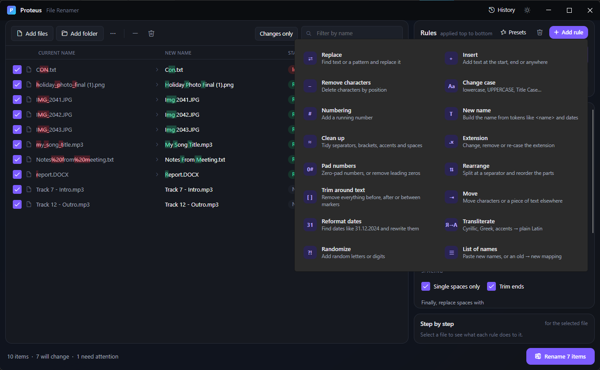

# 3. Working with rules

[Knowledge base](README.md) › Working with rules

A **rule** is one renaming step, such as "replace underscores with spaces" or "add a number". You
build a **stack** of rules, and every file's name passes through them from top to bottom.

## Managing the rule stack

| Action | How |
|---|---|
| Add a rule | **+ Add rule**, then pick one. It is inserted *below the selected rule*. |
| Edit a rule | Click it. Its settings appear in the editor underneath. |
| Turn a rule off temporarily | Untick its checkbox (or use the switch in the editor). Disabled rules fade and do nothing. |
| Reorder | The **⌃ / ⌄** arrows on the rule. |
| Duplicate | The copy icon. Handy for "the same rule, slightly different". |
| Delete | The **×** on the rule. |
| Start fresh | The **bin** icon next to *Add rule*, then **Clear all**. Your files stay in the list. |
| Reuse later | **Presets** → *Save current rules* (see [Presets](10-presets-history.md#presets)). |

Your rule stack is remembered when you close Proteus.

## The rule editor

Every rule has the same frame around its own settings:

- **Header**: the rule's name, a one-line summary of what it does, and an on/off switch.
- **Apply to** (for most rules): what part of the name the rule works on.
- **The rule's settings** (see the [Rule reference](04-rule-reference.md)).
- **Only apply to some files**: a filter for this rule alone.
- **Insert a token**: clickable tokens that drop into the text box you last clicked.

### Apply to: name, extension, or both

| Choice | The rule sees… | Example with `holiday.JPG` |
|---|---|---|
| **Name** (default) | `holiday` | Changing case affects only `holiday` |
| **Extension** | `JPG` (without the dot) | Lowercase → `holiday.jpg` |
| **Name + extension** | `holiday.JPG` | A Replace of `.` → `_` gives `holiday_JPG` |

Rules that only make sense one way (Numbering, Extension, Randomize, List of names, JavaScript) don't show this option.

### Only apply to some files

Open **Only apply to some files** to restrict a rule:

| Setting | Example | Meaning |
|---|---|---|
| Wildcard pattern | `*.jpg; *.png` | Only names ending in .jpg or .png. `*` = any text, `?` = one character, `;` separates patterns. |
| Pattern is a regular expression | `^IMG_\d+` | Only names matching the regex. |
| Apply to files that do NOT match | ✓ | Reverses the filter. |

The pattern is checked against the file's **original** name (with extension), and case doesn't
matter. Rules with a filter show a small funnel icon in the stack. If a regular expression is
invalid, the rule is skipped and a warning appears under its editor.

A Numbering or List of names rule with a filter counts only the files it applies to, so matching
files get 1, 2, 3 with no gaps.

## Rules see the original *and* the current name

Most rules change the name as it stands after the rules above them. Tokens like `<name>` always
mean the **original** name. In the *New name* rule, `<current>` means "the name so far". This lets
you, for example, clean up a name with early rules and then build
`<current> - <exif:taken:yyyy>` at the end.

## When a rule can't do its job

If a rule fails for a file (for example, a script error), that one file is marked **Invalid**, with
the rule's name and the reason. When the same rule fails for many files, the rule shows the first
problem and how many files failed. Other files are unaffected, and nothing is renamed until you fix it.

---

← [Adding and managing files](02-files.md) · Next: [Rule reference](04-rule-reference.md) →
