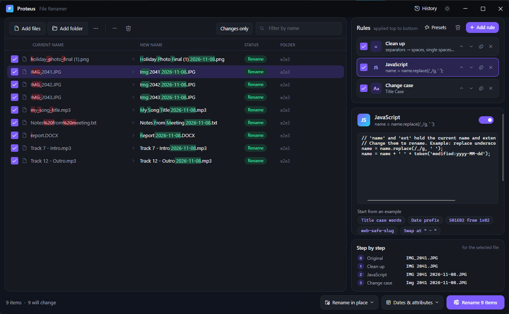

# 6. JavaScript scripting

[Knowledge base](README.md) › JavaScript scripting

When no combination of rules does what you need, write a few lines of JavaScript. A script rule is
a normal rule in the stack: it receives the name as the rules above left it, and its result goes on
to the rules below.



## Add a script

1. **+ Add rule** → **JavaScript**.
2. Edit the script in the editor. The preview updates as you type.
3. Or click one of the **Start from an example** chips to load a ready-made script.

## How a script works

Your script runs **once per file**. Before it runs, Proteus sets up some variables. Your script
changes **`name`** and/or **`ext`**, and whatever they hold at the end becomes the new name.

```js
// name = "my_holiday_photo", ext = "JPG"
name = name.replace(/_/g, ' ');   // "my holiday photo"
ext = ext.toLowerCase();          // "jpg"
// result: "my holiday photo.jpg"
```

- `ext` has no dot. Set `ext = ''` to remove the extension.
- Each file gets a fresh, separate run. `let`, `const` and `var` are all fine, and nothing carries
  over from one file to the next.
- **Don't use `return`** at the top level. Use `if`/`else` instead. The script's last lines hand
  `name` and `ext` back to Proteus automatically.

## The script API

### Variables

| Name | Type | Meaning |
|---|---|---|
| `name` | string | Current name without extension (**change it**) |
| `ext` | string | Current extension without the dot (**change it**) |
| `number` | number | Position among ticked files, starting at **1** |
| `index` | number | Same, starting at **0** |
| `folderIndex` | number | Position within its own folder, starting at 0 |
| `count` | number | Number of files in the batch |
| `isFolder` | boolean | True when the item is a folder |
| `size` | number | Size in bytes (0 for folders) |
| `created` | Date | Creation date and time |
| `modified` | Date | Last modified date and time |
| `original.name` | string | Original name without extension (before any rules) |
| `original.ext` | string | Original extension, no dot |
| `original.fullName` | string | Original name with extension |
| `original.folder` | string | Name of the containing folder |
| `original.path` | string | Full path, e.g. `D:\Photos\IMG_1.jpg` |

### Functions

| Function | Returns | Example |
|---|---|---|
| `token(text)` | Any [token](05-tokens.md) for this file, without the angle brackets | `token('exif:taken:yyyy-MM-dd')` → `"2024-07-14"` |
| `pad(number, width)` | Zero-padded number as text | `pad(7, 3)` → `"007"` |

Everything in standard JavaScript is available: string methods, regular expressions (including
Unicode `\p{L}` with the `u` flag), `Math`, `Date`, arrays, arrow functions, template literals,
`String.prototype.normalize`, and so on.

## Recipes

### Capitalise every word

```js
name = name.toLowerCase().replace(/(^|[\s_-])(\p{L})/gu, (m, sep, ch) => sep + ch.toUpperCase());
```

### Put the date first, from the photo if there is one

```js
const taken = token('exif:taken:yyyy-MM-dd');      // falls back to modified date
name = taken + ' ' + name;
```

### TV episodes: `Show 1x02 Title` → `Show S01E02 Title`

```js
name = name.replace(/(\d{1,2})x(\d{1,3})/i, (m, s, e) => 'S' + pad(s, 2) + 'E' + pad(e, 2));
```

### Web-safe "slug" names

```js
name = name.normalize('NFD').replace(/[\u0300-\u036f]/g, '')   // drop accents
  .toLowerCase()
  .replace(/[^a-z0-9]+/g, '-')                                   // anything else -> dash
  .replace(/^-+|-+$/g, '');                                      // no dashes at the ends
ext = ext.toLowerCase();
```

### Swap two parts

```js
const parts = name.split(' - ');
if (parts.length === 2) name = parts[1] + ' - ' + parts[0];
```

### Number in groups of 10 (`A-01` … `A-10`, `B-01` …)

```js
const group = String.fromCharCode(65 + Math.floor(index / 10));
name = group + '-' + pad(index % 10 + 1, 2) + ' ' + name;
```

### Sort by size into labels

```js
const mb = size / 1048576;
const label = mb > 100 ? 'large' : mb > 10 ? 'medium' : 'small';
name = `[${label}] ${name}`;
```

### Use the date in the format you want

```js
const d = modified;
const two = n => String(n).padStart(2, '0');
name = `${d.getFullYear()}${two(d.getMonth() + 1)}${two(d.getDate())}_${name}`;
```

### Only touch some files

```js
if (ext.toLowerCase() === 'pdf' && size > 0) {
  name = 'Document - ' + name;
}
// other files keep their name
```

The rule's **Only apply to some files** filter works for scripts too, and is often simpler.

### Different handling for folders

```js
if (isFolder) {
  name = name.toUpperCase();
} else {
  name = pad(number, 3) + ' ' + name;
}
```

### Build a name from music tags, with fallbacks

```js
const artist = token('music:artist') || 'Unknown Artist';
const title  = token('music:title')  || original.name;
const track  = token('music:track:2');
name = (track ? track + ' ' : '') + artist + ' - ' + title;
```

## Errors

If the script has a mistake, a red box under the editor explains it, with the **line number** as you
see it in the editor:

```
Script error: undefinedThing is not defined (line 2)
```

Any file the script fails on is marked **Invalid** in the list and won't be renamed. When it fails on
more than one file, the box shows the first problem and how many files failed, for example
`(12 files failed; the first problem is shown)`. Fix the script and the preview updates at once.

## Limits and safety

Scripts run in a sandbox:

- No access to files, folders, the network, other programs or .NET. A script can only compute a name.
- Each file gets at most **half a second**, **2 million steps** and **64 MB** of memory, and
  recursion is limited. An endless loop is stopped with a clear message.

The engine is [Jint](https://github.com/sebastienros/jint), a JavaScript interpreter written in
.NET (BSD-2-Clause license). It supports modern JavaScript (ES2015 and later).

## Tips

- Select a file and watch **Step by step** to see the name before and after your script.
- Keep scripts small and combine them with normal rules: a Clean up rule before the script, an Extension rule after.
- Scripts are saved with your rule stack and in [presets](10-presets-history.md#presets), so you can reuse them.

---

← [Tokens and metadata](05-tokens.md) · Next: [Copy and move](07-copy-move.md) →
