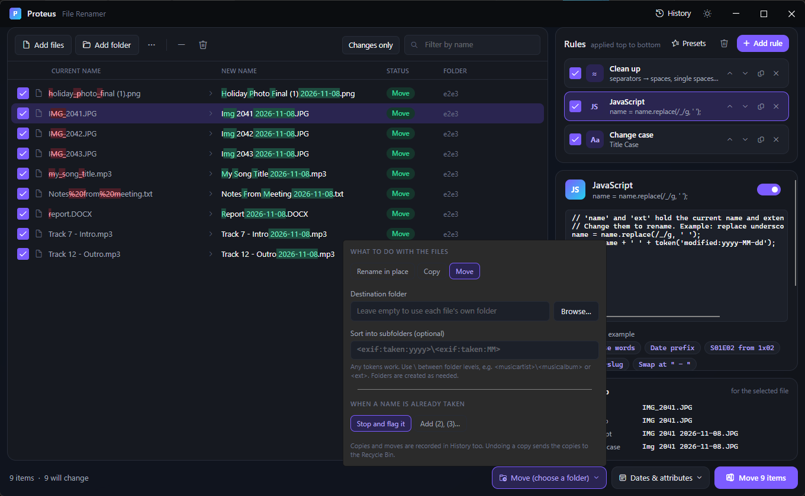

# 7. Copy and move

[Knowledge base](README.md) › Copy and move

By default Proteus **renames files where they are**. It can also **copy** or **move** them into another
folder, optionally sorted into subfolders, while renaming them at the same time.

## Choose the mode

Click the mode button at the bottom (it says **Rename in place** by default):

| Mode | What happens |
|---|---|
| **Rename in place** | Files keep their folder; only names change. |
| **Copy** | New copies are made with the new names; the originals stay untouched. |
| **Move** | Files are moved to the destination with their new names. |

The button turns purple when you're copying or moving, and the main button says **Copy N items** or
**Move N items**. Proteus always starts in *Rename in place*, so copy and move never carry over by
accident from a previous session.

## Destination folder

- Type a path or click **Browse…**.
- **Leave it empty** to use each file's own folder. That's useful together with subfolders, for
  example to sort a folder's contents into subfolders right where they are.
- A **relative** name such as `Sorted` means a folder called `Sorted` *inside each file's own folder*.
- Folders that don't exist are created. If you undo, folders Proteus created are removed again (when empty).

The **Folder** column shows `→ destination` for every file, and *Step by step* shows the full destination.

## Sort into subfolders

The **Sort into subfolders** pattern builds a folder path for each file from [tokens](05-tokens.md).
Use `\` (or `/`) between folder levels.

| Pattern | Result |
|---|---|
| `<exif:taken:yyyy>\<exif:taken:MM>` | `2024\07\IMG_2041.jpg` |
| `<music:artist>\<music:album>` | `Radiohead\OK Computer\01 Airbag.mp3` |
| `<ext>` | `pdf\report.pdf`, `jpg\photo.jpg` |
| `<video:quality>` | `4K\clip.mp4`, `1080p\other.mkv` |
| `<doc:author>\<doc:created:yyyy>` | `Jane Doe\2023\Proposal.docx` |
| `<modified:yyyy-MM>` | `2024-03\notes.txt` |

Characters Windows doesn't allow in folder names are replaced with `_`. Reserved names such as `CON`
get a `_` added, and empty parts are skipped.

## When a name is already taken

| Choice | Behaviour |
|---|---|
| **Stop and flag it** (default) | The file is marked **Conflict** and skipped; nothing is overwritten. |
| **Add (2), (3)…** | Proteus picks the next free name: `photo (2).jpg`, `photo (3).jpg`. |

The *Add (2), (3)* option applies in all modes, including rename in place. Proteus **never**
overwrites an existing file in any mode.

## Undo

- **Move / rename**: files go back where they came from, with their old names, and created folders are removed.
- **Copy**: the copies are sent to the **Recycle Bin**, with two safeguards:
  - A copy that has been **changed since** (different size or modified time) is left in place, and you're told.
  - On drives **without a Recycle Bin** (network shares, USB sticks), copies are left in place
    rather than deleted permanently, and you're told so you can delete them yourself.

## Examples

**Organise a camera dump by year and month**
1. Add the folder of photos.
2. Rules: *New name* `<exif:taken:yyyy-MM-dd_HHmmss>`, *Extension* lowercase.
3. Mode: **Move**, destination `D:\Pictures`, subfolders `<exif:taken:yyyy>\<exif:taken:MM>`.
4. Conflicts: **Add (2), (3)…** (for burst shots taken in the same second).

**Back up documents with dated names, keeping the originals**
1. Add the files.
2. Rule: *Insert* `<modified:yyyy-MM-dd> ` at the start.
3. Mode: **Copy**, destination `E:\Backup\Docs`.

**Sort a Downloads folder by type, in place**
1. Add `Downloads` (untick *Include files in subfolders* in the `...` menu first).
2. No rules needed.
3. Mode: **Move**, destination empty, subfolders `<ext>`.

---

← [JavaScript scripting](06-javascript.md) · Next: [Dates and attributes](08-dates-attributes.md) →
