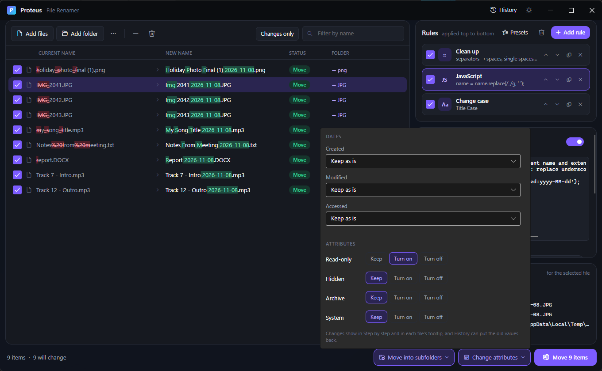

# 8. Dates and attributes

[Knowledge base](README.md) › Dates and attributes

Proteus can change a file's **Created**, **Modified** and **Accessed** dates and its **Read-only**,
**Hidden**, **Archive** and **System** attributes, together with a rename or on their own.

## Open the panel

Click **Dates & attributes** at the bottom. The button turns purple and reads *Change dates* or
*Change dates & attributes* while anything is set.

## Dates

Each of the three dates has its own setting:

| Setting | New value |
|---|---|
| **Keep as is** | No change (default) |
| **Set to a date and time** | The date and time you pick |
| **Now** | The moment you press the button |
| **Photo date taken (EXIF)** | From the camera data |
| **Video / audio recorded date** | From the media file |
| **Document created date** | From inside a Word/Excel/PowerPoint/PDF/OpenDocument file |
| **A date found in the file name** | Parsed from the name using a pattern you give |
| **Copy from Created / Modified / Accessed** | Another of the file's own dates |

**Then shift by (minutes, ±)**: added to the result. Use `60` for one hour later, `-1440` for one
day earlier. This is ideal for fixing a camera clock set to the wrong time zone.

### Dates from file names

Give the pattern the date is written in, using the [date format letters](05-tokens.md#date-formats).
Several patterns can be separated by `;`.

| File name | Pattern |
|---|---|
| `IMG_20240131_093000.jpg` | `yyyyMMdd_HHmmss` |
| `Scan 2024-01-31.pdf` | `yyyy-MM-dd` |
| `Screen Recording 2024-01-31 093000.mp4` | `yyyy-MM-dd HHmmss` |
| `PXL_20240131_093000123.jpg` | `yyyyMMdd` (the time here runs into extra digits, so match the day only) |

A pattern only matches when it isn't directly touching other digits. Use the date part alone when
the time has extra digits.
| `Screenshot 31.01.2024.png` | `dd.MM.yyyy` |

Files where no date is found, or where the metadata is missing, are left unchanged.

## Attributes

For each attribute choose **Keep**, **Turn on** or **Turn off**:

| Attribute | Meaning |
|---|---|
| **Read-only** | Programs can't save over the file |
| **Hidden** | Hidden in File Explorer unless "Hidden items" is shown |
| **Archive** | Marks the file as changed since the last backup (used by some backup tools) |
| **System** | A Windows system file (rarely useful to change) |

## Preview and status

- Files whose name stays the same but whose dates or attributes change show **Update**.
- Only *real* changes count: setting a date to the value it already has, or turning on an attribute
  that's already on, isn't counted.
- Hover a row, or select it and look at **Step by step**, to see exactly what will change, e.g.
  `modified 2020-01-02 04:04, +ReadOnly`.

## Undo

Proteus records each file's previous dates and attributes before changing them. Undo puts them back,
from the notice bar right away or from **History** at any time later.

## Examples

**Make files' modified dates match the date in their names**
Modified → *A date found in the file name*, pattern `yyyyMMdd_HHmmss`.

**Fix photos from a camera that was an hour behind**
Created and Modified → *Photo date taken*, shift `60`.

**Protect a finished set of files**
Read-only → *Turn on*. No rules needed: the button reads **Update N items**.

---

← [Copy and move](07-copy-move.md) · Next: [Names from a folder or a CSV](09-csv.md) →
