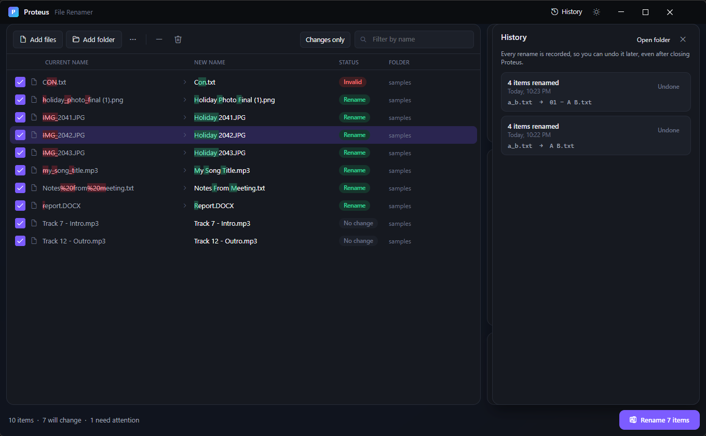

# 10. Presets, history and undo

[Knowledge base](README.md) › Presets, history and undo

## Presets

A preset saves your **rule stack** and your **copy/move and dates & attributes settings** under a
name, so you can reuse them with one click.

| Action | How |
|---|---|
| Save | **Presets** → type a name under *Save current rules* → **Save** |
| Load | **Presets** → click the name. This replaces the current rules and settings. If the preset also sets a copy or move mode, a destination, or date and attribute changes, a message says so, so a preset can't quietly switch you to *Move*. |
| Delete | **Presets** → the bin next to the name |

Presets are stored as small JSON files you can back up or share (see
[where things are stored](12-settings-portable.md#where-things-are-stored)). Saving with a name that
already exists asks first: click **Save** a second time to replace that preset.

Even without presets, Proteus remembers your last rule stack when you close it.

## Undo right away

After every batch a message appears at the bottom with an **Undo** button (it stays for a few
seconds). **Ctrl+Z** does the same while you're not typing in a text box.

## History

Click **History** in the title bar. Every batch is listed, newest first:

- **N items renamed / moved / copied / updated**, when it happened, and one example.
- **Undo** reverts that batch, even days later and after restarting Proteus.
- Batches that have been undone show **Undone**.
- Batches where only some items could be put back show **partly undone, N left**. Fix what stopped
  them (for example, close a file that was open) and click **Undo** again; items already restored
  are not touched a second time.
- **Open folder** shows where history is stored.

### What undo does

| The batch… | Undo… |
|---|---|
| Renamed or moved files | Moves them back to their old names and places, and removes folders the batch created (if they are empty) |
| Copied files | Sends the copies to the Recycle Bin, but leaves a copy alone if it was changed since or is on a drive without a Recycle Bin |
| Changed dates or attributes | Restores the previous values |

If a file was moved or deleted outside Proteus since the batch, undo skips it and tells you; it never
guesses. A batch is only marked *Undone* once everything in it has been restored; until then it
stays *partly undone*.

### Interrupted batches

Proteus writes the full plan to History **before** it touches any file. If the PC loses power or
Proteus is closed in the middle of a batch:

- On the next start, a message tells you a batch was interrupted.
- History shows it as **… planned · interrupted**.
- **Undo** puts back whatever had already happened, including files that were part-way through a
  swap and still had a temporary name (`.proteus-….tmp`).

While a batch is running, Proteus won't close; it asks you to wait.

### How much is kept

The newest 500 batches are kept. Older entries are removed automatically.

---

← [Names from a folder, a style or a CSV](09-csv.md) · Next: [Safety and status messages](11-safety.md) →
