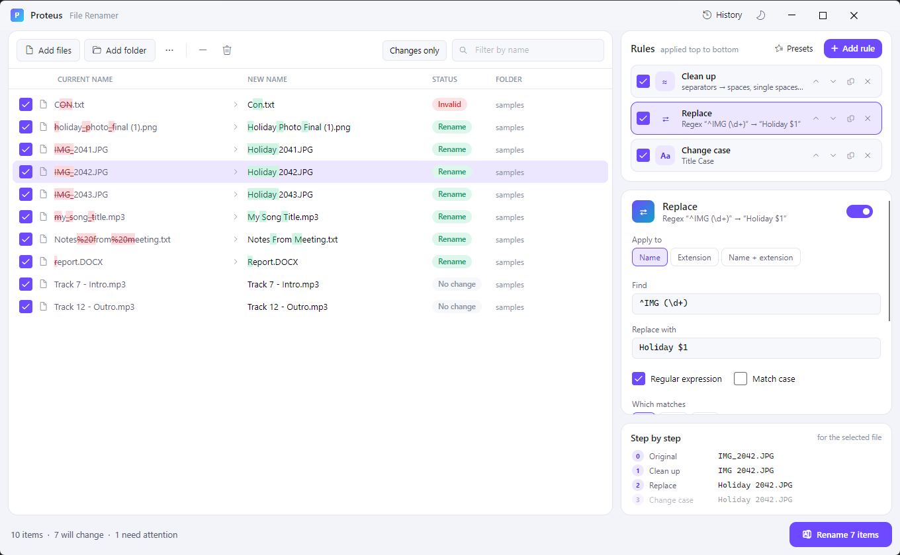

# 12. Settings and portable mode

[Knowledge base](README.md) › Settings and portable mode

## Appearance

- **Light / dark**: the sun/moon button in the title bar. Your choice is remembered.
- **Highlight changed characters**: in the `...` menu above the list.



## What Proteus remembers

Between sessions Proteus remembers:

- theme, *Include files in subfolders*, *Highlight changed characters*
- your current rule stack
- the destination folder, subfolder pattern, conflict choice, and dates & attributes settings

The **mode** always starts as *Rename in place*, on purpose, so you never copy or move by accident.

## Where things are stored

| What | Normal location | Portable mode |
|---|---|---|
| Settings and last rule stack | `%APPDATA%\Proteus\settings.json` | `Data\settings.json` |
| Presets | `%APPDATA%\Proteus\Presets\*.json` | `Data\Presets\` |
| History (undo) | `%LOCALAPPDATA%\Proteus\History\*.json` | `Data\History\` |
| Error log | `%LOCALAPPDATA%\Proteus\proteus.log` | `Data\proteus.log` |

Type `%APPDATA%\Proteus` into File Explorer's address bar to open the folder. **History → Open folder** opens the history folder.

## Portable mode

To run Proteus from a USB stick or a synced folder **without writing anything to the PC**:

1. Put `Proteus.exe` in a folder.
2. Create an **empty file** named `portable.txt` in the same folder.
3. Start Proteus. Everything is now kept in a `Data` folder next to the exe.

```
Proteus\
├─ Proteus.exe
├─ portable.txt
└─ Data\            ← created automatically
```

To go back to normal mode, delete `portable.txt`. Each mode keeps its own settings and history.

## Requirements

- Windows 10 or 11, 64-bit.
- No installation, and no .NET needed for the published `Proteus.exe`.
- Icons use the *Segoe Fluent Icons* font that ships with Windows 11 and recent Windows 10.

---

← [Safety and status messages](11-safety.md) · Next: [Recipes](13-recipes.md) →
